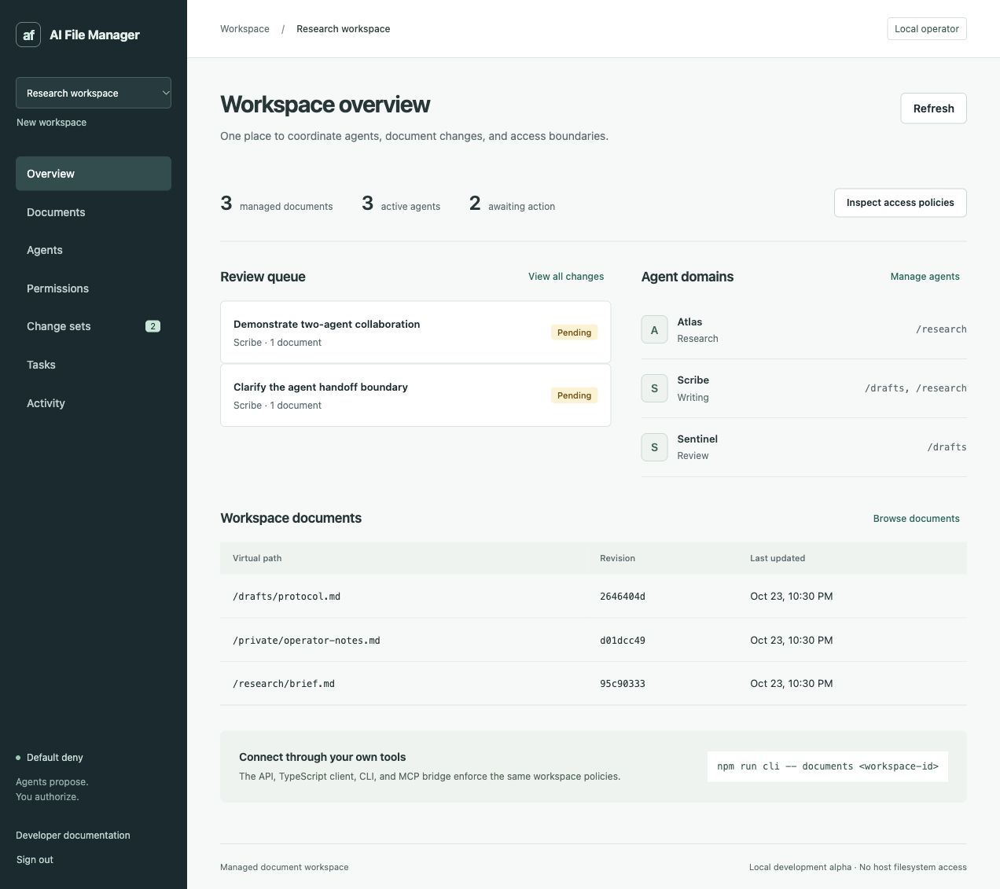

# AI File Manager

**Permission-aware document workspaces for collaborative AI agents.**

AI File Manager explores how independent AI tools can collaborate on documents while keeping identity, authority, and version history explicit. It provides a local control plane, an administrative web console, and developer interfaces for scoped document access.

**Status: local development alpha.** The first vertical slice is runnable. Managed text documents, policies, change review, version history, and agent handoffs are implemented. Hosted multi-tenancy, OS sandboxing, arbitrary filesystem mounts, and model execution are not implemented.



## What it does

- Give each agent a separate token, responsibility domain, and document scope.
- Enforce default-deny access, explicit deny rules, expiration, and revocation.
- Accept immutable multi-document proposals instead of unrestricted direct writes.
- Separate advisory agent reviews from human approval and application.
- Recheck current authority and revision heads before an atomic transaction.
- Preserve revisions and deletion tombstones; restore through new proposals.
- Coordinate task assignment and handoffs without transferring permissions.
- Retry proposals and application with durable, explicitly scoped idempotency keys.
- Browse metadata in bounded pages and fetch document or proposal text on demand.
- Integrate through REST, a TypeScript client, CLI, and nine MCP tools.

The service does not call an LLM. Your connected agents run their own models and use the same permission boundary, regardless of provider or framework.

## Quick start

Requires **Node.js >=22.13**, npm, and macOS or Linux. SQLite bindings normally install from prebuilt binaries; platforms without a matching binary need Python and a C++ build toolchain. Windows permission semantics have not been validated.

```bash
git clone https://github.com/arnoldsa2769/ai-file-manager.git
cd ai-file-manager
npm ci
npm run setup
npm run demo
npm run dev
```

Open [http://127.0.0.1:5173](http://127.0.0.1:5173). Read `AFM_ADMIN_TOKEN` from the generated private `.env` and paste it into the sign-in form. Do not share it with agents. The browser keeps it in session storage until sign-out or session termination.

The optional demo creates synthetic documents, three scoped agents, one pending proposal, and a review task. Agent tokens are saved only in ignored `data/demo-agents.json`. Demo seeding is explicit and refuses to repeat against an existing demo workspace.

For an existing installation, back up before starting this revision: the service upgrades SQLite schema 1 to 2 automatically. See [upgrade and rollback instructions](docs/operations.md#schema-and-upgrades).

## Try the collaboration loop

1. Open **Change sets** and select the pending Scribe proposal.
2. Inspect the exact before/after snapshots and Sentinel's advisory review.
3. Choose **Approve change**, then **Apply change**.
4. Open **Documents**, select the draft, and inspect **Version history**.
5. Add or revoke a grant under **Permissions** and observe subsequent agent requests.

With the API running, `npm run example` demonstrates two independent agent clients proposing and reviewing another synthetic draft. It does not require a model API key and leaves application to the operator.

## Architecture

```text
Web console     Agent frameworks / AI tools
     |             |       |        |
     |           SDK      CLI      MCP
     +-------------+-------+--------+
                   REST API
                       |
           Identity and policy checks
                       |
          Transactional workspace service
                       |
       SQLite: documents, revisions, proposals,
       grants, tasks, review notes, activity
```

| Area                  | Technology                      | Rationale                                                         |
| --------------------- | ------------------------------- | ----------------------------------------------------------------- |
| Runtime and contracts | Node.js, strict TypeScript, Zod | One typed language across integrations and console                |
| Backend               | Fastify                         | Small HTTP boundary around a transport-independent domain service |
| Persistence           | SQLite, better-sqlite3, WAL     | Local setup and atomic multi-document revision checks             |
| Frontend              | React, Vite, plain CSS          | Operational review UI with a separate development server          |
| Agent integration     | REST and official MCP SDK       | Provider-neutral tools with per-agent identity                    |
| Verification          | Node test runner, Playwright    | Real policy, persistence, API, MCP, and browser workflows         |

Read the [architecture](docs/architecture.md), [technology decisions](docs/adrs/001-technology-stack.md), and [threat model](docs/threat-model.md) before extending the trust boundary.

## Developer commands

```bash
npm test                 # Domain, HTTP, SDK, MCP, setup, and backup tests
npm run typecheck        # Backend and frontend strict type checks
npm run build            # Compile service, integrations, and console
npm start                # Serve compiled console and API on port 7310
npm run language-check   # Reject CJK text in repository-authored files
npm run format:check     # Check source and document formatting
npx playwright install chromium
npm run test:browser     # Isolated real browser workflows
```

For CLI usage, set `AFM_TOKEN` to a scoped agent token and optionally `AFM_URL`, then run `npm run cli -- --help`. The compiled SDK is an internal repository module; no npm package has been published.

## Repository map

```text
apps/server/       HTTP service and production static hosting
apps/web/          Administrative console
packages/core/     Policy and transactional domain service
packages/sdk/      TypeScript HTTP client
packages/cli/      Command-line client
packages/mcp/      Scoped stdio MCP bridge
scripts/           Setup, synthetic demo, backup, and repository checks
examples/          Deterministic multi-agent collaboration example
tests/             Domain, transport, integration, and browser tests
docs/              Architecture, policy, protocol, operations, and decisions
```

## Documentation

- [Concepts](docs/concepts.md)
- [Permission model](docs/permission-model.md)
- [Agent domains](docs/agent-domains.md)
- [Collaboration protocol](docs/collaboration-protocol.md)
- [Document versioning](docs/document-versioning.md)
- [API reference](docs/api.md)
- [SDK, CLI, and MCP integration](docs/integrations.md)
- [Operations and backups](docs/operations.md)
- [Changelog](CHANGELOG.md) and [Roadmap](ROADMAP.md)
- [Contributing](CONTRIBUTING.md) and [security reporting](SECURITY.md)

## Trust boundaries

The server binds to loopback. Treat this as a single-operator development system, not an internet-facing service. Permissions apply to managed document operations routed through this API. They do not constrain a process that already has independent host filesystem or network access.

Documents and revisions contain private material. The database is not encrypted at rest. Activity records are append-only through the API, not tamper-proof against the host administrator. Text received from documents or other agents is untrusted data and cannot authorize access.

## Authors

- [arnoldsa2769](https://github.com/arnoldsa2769)
- [m.ramadan001@binus.ac.id](mailto:m.ramadan001@binus.ac.id)

## License

[MIT](LICENSE). Third-party libraries, model providers, and contributed assets remain subject to their own terms.
